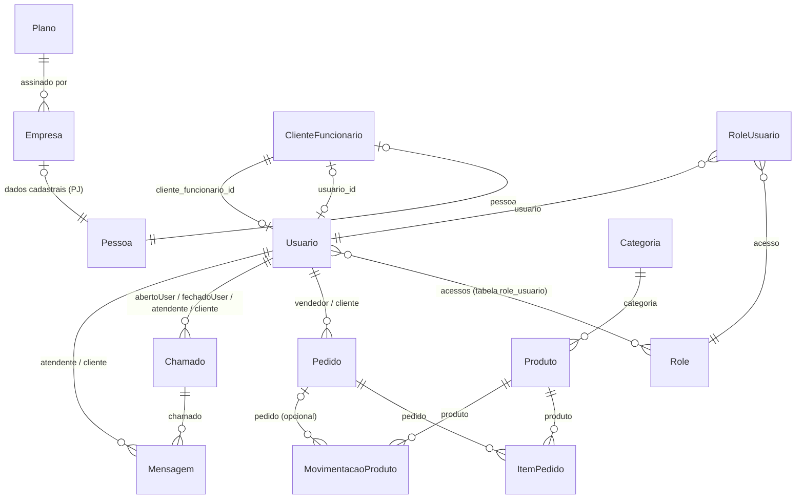

# Arquitetura — Jdev ERP Pro (back-end)

Gerado a partir do código de `jdev-erp-pro-back-end-dev/` em 2026-10-28. Detalhes técnicos de build, dependências e dívidas estão em `docs/analise-projeto.md`. As regras de negócio estão em `docs/regras-negocio.md`.

## 1. Visão geral

- API REST stateless de um ERP SaaS multiempresa: cada empresa cliente (tenant) assina um `Plano` e só enxerga os próprios dados.
- Monólito Spring Boot 4 (Java 25) organizado **por camada** (`controller` → `service` → `repository` → `model`), sobre PostgreSQL via JPA/Hibernate.
- O isolamento entre empresas é feito na aplicação, não no banco:
  - toda entidade de negócio tem a FK `empresa_id`;
  - um repositório base (`JpaJdevRepositoryImpl`) e um validador de subida (`RepositoryEmpresaValidator`) obrigam toda consulta a filtrar por empresa.
- A autenticação usa JWT, e o token emitido também fica gravado no usuário: só a sessão mais recente vale.
- Não há front-end neste repositório nem integrações externas.

## 2. Módulos de negócio

Todos os módulos compartilham os mesmos pacotes de camada: `br.com.jdeverp.pro.controller`, `.service`, `.repository` e `.model`. Não existe um pacote por módulo. Rotas relativas ao context-path `/jdev-erp-pro-back-end-dev`.

| Módulo | Entidades (`model`) | Services (`service`) | Rota raiz | Endpoints |
|---|---|---|---|---|
| Acesso e usuários | `Usuario`, `Role`, `RoleUsuario` | `UsuarioService`, `UsuarioDetailsService`, `JwtService`, `UsuarioLogadoService`, `RoleService`, `RoleUsuarioService` | `/api/usuario`, `/api/role`, `/api/roleUsuario` | 16 + 8 + 9 |
| SaaS: planos e empresas | `Plano`, `Empresa` | `PlanoService`, `EmpresaService` | `/api/plano`, `/api/empresa` | 8 + 8 |
| Cadastros | `Pessoa`, `ClienteFuncionario` | `PessoaService`, `ClienteFuncionarioService` | `/api/pessoa`, `/api/clienteFuncionario` | 15 + 16 |
| Produtos e estoque | `Categoria`, `Produto`, `MovimentacaoProduto` | `CategoriaService`, `ProdutoService`, `MovimentacaoProdutoService` | `/api/categoria`, `/api/produto`, `/api/movimentacaoProduto` | 11 + 15 + 20 |
| Vendas | `Pedido`, `ItemPedido` | `PedidoService`, `ItemPedidoService` | `/api/pedido`, `/api/itemPedido` | 15 + 20 |
| Atendimento (suporte) | `Chamado`, `Mensagem` | `ChamadoService`, `MensagemService` | `/api/chamado`, `/api/mensagem` | 8 + 33 |

- Cada rota raiz tem um controller com o mesmo nome da entidade, por exemplo `CategoriaController` → `/api/categoria`. São 14 controllers e 202 endpoints.
- Cada entidade tem um repository `<Entidade>Repository extends JpaJdevRepository<Entidade, Long>`.
- Os enums de domínio ficam em `br.com.jdeverp.pro.enums`:
  - `TipoPlano`
  - `TipoPessoa`
  - `TipoClienteFuncionario`
  - `UnidadeMedida`
  - `TipoMovimentacaoProduto`
  - `StatusPedido`
  - `FormaPagamento`
  - `TipoPedido`
  - `TipoChamado`
  - `PrioridadeChamado`
  - `StatusChamado`
- Endpoints que vão além do CRUD padrão:
  - `ItemPedido`, `MovimentacaoProduto` e `Mensagem` têm variantes filtradas pelo pai: `/listarPorPedido/{idPedido}`, `/listarPorChamado/{idChamado}`, `/deletarPorPedido/{id}/{idPedido}`.
  - `Mensagem` tem ainda consultas de não lidas e por atendente/cliente.
  - `Pessoa`, `Produto`, `Pedido`, `ItemPedido`, `MovimentacaoProduto`, `ClienteFuncionario`, `Mensagem` e `Usuario` têm exclusão em massa: `DELETE /deletarTodos`, `/deletarTodosPorIds` (no `UsuarioController`, `/deletar-todos`).

## 3. Relacionamentos

As entidades `Pessoa`, `ClienteFuncionario`, `Usuario`, `Categoria`, `Produto`, `MovimentacaoProduto`, `Pedido`, `ItemPedido`, `Chamado` e `Mensagem` têm, além do que o diagrama mostra, `N:1` para `Empresa` (o tenant, coluna `empresa_id`). Essa ligação foi omitida do diagrama para não poluir.
São globais, sem `empresa_id`: `Plano`, `Empresa`, `Role` e `RoleUsuario`.

Observações:
- **`Usuario` ↔ `ClienteFuncionario` têm FK dos dois lados.** `usuario.cliente_funcionario_id` (obrigatória) e `cliente_funcionario.usuario_id` (opcional). Ambos os lados são preenchidos por `UsuarioService.salvar()`.
- **`Usuario.acessos` e `RoleUsuario` mapeiam a mesma tabela `role_usuario`.** `Usuario.acessos` é um `@ManyToMany` EAGER. `RoleUsuario` é a entidade usada pelo CRUD `/api/roleUsuario`.
- **O "cliente" de `Pedido`, `Chamado` e `Mensagem` é um `Usuario`**, não uma `Pessoa` nem um `ClienteFuncionario`.
- **Não há nenhum `@OneToMany` ativo.** `Plano.empresas` está comentado de propósito: o comentário diz que um plano pode ter milhares de empresas, o que deixaria a carga lenta.
- **Todos os relacionamentos são unidirecionais** (`@ManyToOne`/`@OneToOne`), em geral `LAZY`. As exceções são `Produto.categoria`, `Usuario.empresa` e `Usuario.acessos`, que são `EAGER`.
- **`Empresa` e `ClienteFuncionario` aparecem só pelo id no JSON**, porque usam `@JsonIdentityInfo` + `@JsonIdentityReference(alwaysAsId = true)`.

## 4. Fluxo de uma requisição autenticada

1. **Tomcat** (porta 8081, context-path `/jdev-erp-pro-back-end-dev`) → cadeia do Spring Security definida em `security/SecurityConfig#securityFilterChain`.
2. **CORS** (`SecurityConfig#corsConfigurationSource`) → **`security/JwtFilter`** (`OncePerRequestFilter`, registrado antes de `UsernamePasswordAuthenticationFilter`):
   1. Sem `Authorization: Bearer ...`, a requisição segue anônima. Só `POST /api/usuario/login` aceita requisição anônima.
   2. `JwtService.extrairLogin(token)` confere a assinatura HMAC (chave de `jwt.secret`) e a expiração, e lê o `subject` (login).
   3. `UsuarioDetailsService.existsByTokenParaUser(token)` extrai `usuarioId` e `empresaId` dos claims e chama `UsuarioRepository.existsByTokenParaUser`. Essa query nativa exige `usuario.token_sessao = token`.
   4. `UsuarioDetailsService.loadUserByUsername(login)` chama `UsuarioRepository.buscaPorLogin` e recusa usuário não liberado ou empresa bloqueada.
   5. `new UsuarioAutenticado(usuario)` → `UsernamePasswordAuthenticationToken(principal, token, authorities)` → `SecurityContextHolder`.
   6. **Token recusado** nos passos 2 a 4: a requisição segue sem autenticação e o motivo fica no atributo `JwtFilter.ATRIBUTO_MOTIVO_RECUSA`. Numa rota protegida, o `JwtAuthenticationEntryPoint` responde 401 com esse motivo na `message`; o login continua aberto mesmo com um token velho no header. O log registra só o motivo e a rota, nunca o token.

      | Caso | `message` do 401 |
      |---|---|
      | sem token | "Usuário não autenticado ou token inválido" |
      | mal formado ou assinatura que não confere | "Token de acesso inválido." |
      | vencido | "Token de acesso expirado, faça login novamente." |
      | não é o token gravado (novo login) | "Sessão encerrada ou substituída por um novo login, faça login novamente." |
      | usuário ou empresa bloqueados depois do login | as mesmas mensagens do login |

   7. **Erro que não é de autenticação** (ex.: banco fora do ar): o filtro entrega a exceção ao `GlobalExceptionHandler` pelo `HandlerExceptionResolver` e a resposta é 500 em `ResponseApi`.
3. **Autorização** (`authorizeHttpRequests`):
   - `/api/usuario/login` é público;
   - `/api/admin/**` exige `ROLE_ADMIN` (nenhum controller usa esse prefixo);
   - o resto exige estar autenticado.
   - Falhas: `JwtAuthenticationEntryPoint` responde 401 e `JwtAccessDeniedHandler` responde 403, ambos com JSON `ResponseApi`.
4. **`DispatcherServlet` → `@RestController`** (ex.: `controller/CategoriaController`). O `@Valid` aplica a Bean Validation da entidade ou DTO.
5. O controller (ou o service) obtém o tenant com **`service/UsuarioLogadoService.getEmpresaIdLogada()`**, que lê o `UsuarioAutenticado` do `SecurityContext`.
6. **Service** (ex.: `service/CategoriaService`): regras de negócio. Uma violação lança `MsgApiException`.
7. **Repository** (ex.: `repository/CategoriaRepository`):
   - O caminho é `@Query` JPQL com `empresa.id`, ou um método genérico de `repository/JpaJdevRepositoryImpl` (`buscarPorId(id, empresaId)`, `listarPaginado`...).
   - Daí segue para o Hibernate (funções `unaccent`/`similarity` de `config/PostgreSQLFunctionContributor`) → HikariCP → PostgreSQL.
8. **Resposta:**
   - sucesso: `ResponseEntity.ok(...)`, serializado pelo Jackson;
   - exceção dentro do MVC: `exception/GlobalExceptionHandler` → `ResponseApi` `{localDateTime, status, error, message, path}`;
   - token recusado: 401 do `JwtAuthenticationEntryPoint`; erro inesperado no `JwtFilter`: 500 pelo `GlobalExceptionHandler` (passos 2.6 e 2.7).
- Transações: `spring.jpa.open-in-view=false`. Cada service tem `@Transactional(readOnly = true)` na classe e `@Transactional` nos métodos de escrita; a sessão do Hibernate só existe dentro do método do service, que já devolve DTO ao controller. O usuário do `JwtFilter` é carregado fora dessa sessão (relacionamentos LAZY não podem ser lidos nele).
- Enum no JSON: sempre pelo nome (`CARTAO_CREDITO`), não pelo `toString()`, por causa do `config/ConfiguracaoJackson` (o padrão do Jackson 3 seria o `toString()`).
- Na subida da aplicação:
  - `validator/RepositoryEmpresaValidator` (`SmartInitializingSingleton`) recusa repositories com métodos sem `@Query` ou sem filtro de empresa (exceção: `@IgnoreEmpresaId`);
  - `JDevERPPROApplication.configTimeZone()` fixa `America/Sao_Paulo` e `pt_BR`.

## 5. Segurança

**Login** (`POST /api/usuario/login`, corpo `LoginDTO {login, senha}`), feito por `UsuarioService.login()`:
1. `UsuarioRepository.buscaPorLogin(login)` busca o usuário só pelo login, sem empresa (método com `@IgnoreEmpresaId`).
2. Recusa com 401 se:
   - o usuário não existe;
   - `liberado=false`;
   - `empresa.bloqueio=true`;
   - a senha não confere no BCrypt.
3. `AuthenticationManager.authenticate(...)`, configurado em `SecurityConfig#authenticationManager` com `UsuarioDetailsService` + `BCryptPasswordEncoder`.
4. `JwtService.gerarToken(usuario)` gera o token com:
   - `subject` = login;
   - claims `usuarioId`, `empresaId` e `login`;
   - validade `jwt.expiration` (86400000 ms = 24h).
5. `UsuarioRepository.updateTokenSessaoLogin(...)` grava o token em `usuario.token_sessao`. Por isso, um novo login invalida o token anterior.
6. A resposta é `TokenDTO {token}`. O cliente envia `Authorization: Bearer <token>` nas próximas requisições.

**Roles:**
- **Onde ficam:** tabela `role`, campo `acesso`, entidade `model/Role implements GrantedAuthority`. O seed fica em `src/main/webapp/db_sql_versionamento/V1_INIT.sql`: `ROLE_USER` (id 1) e `ROLE_ADMIN` (id 2).
- **Criação de roles:** via `/api/role` (`RoleService`). O nome precisa começar com `ROLE_` e é gravado em maiúsculas (`Role.setAcesso`).
- **Atribuição a usuários:** tabela `role_usuario`, via `/api/roleUsuario` (`RoleUsuarioService`). Todo usuário novo recebe `ROLE_USER` em `UsuarioService.salvar()`.
- **Como chegam ao Spring:** `Usuario.getAuthorities()` devolve `Usuario.acessos`.
- **Checagem de admin:**
  - `Usuario.idAdmin()` verifica se o usuário tem `ROLE_ADMIN`, e `UsuarioLogadoService.isAdmin()` expõe essa verificação.
  - É usada em `EmpresaService` (salvar, atualizar, deleteById) e em `UsuarioService` (salvar, atualizar).
  - `ROLE_ADMIN` é global: não é restrito a uma empresa.
- **`@EnableMethodSecurity`:** ligado (`prePostEnabled`, `jsr250Enabled`, `securedEnabled`), mas sem nenhum `@PreAuthorize`, `@Secured` ou `@RolesAllowed` no código.

**Rotas e outros:**
- **Rota pública:** só `POST /api/usuario/login`.
- **Outros pontos:**
  - CSRF desligado;
  - sessão `STATELESS`;
  - CORS liberado para qualquer origem, com credenciais;
  - a senha nunca volta na resposta: campos de `Usuario` com `@JsonIgnore`, e `UsuarioDto.senha` mascarada.

## 6. Configuração e perfis

| Arquivo (`src/main/resources/`) | Para que serve |
|---|---|
| `application.properties` | Só define `spring.profiles.active=${SPRING_PROFILES_JDEV_ERP_PRO:dev}`. O perfil vem de uma variável de ambiente própria do projeto, documentada em `documentação/1 - Documentação`. |
| `application-dev.properties` | Perfil padrão de desenvolvimento. PostgreSQL local (porta 5433), porta 8081, context-path `/jdev-erp-pro-back-end-dev`, Hikari (até 15 conexões), `ddl-auto=update`, log em `jdev-erp-pro-back-end-dev.log`, segredo JWT e expiração. |
| `application-prod.properties` | Perfil de produção. Hoje é uma cópia do dev (mesmo banco, porta, context-path e log). |

- Não existe perfil `test`. Os testes (`TestContextoSpring`) carregam `application.properties` e, por padrão, rodam no perfil `dev`, contra o banco dev.
- O schema é mantido pelo Hibernate (`ddl-auto=update`) nos dois perfis. Scripts SQL manuais ficam em `src/main/webapp/db_sql_versionamento/`.
- Beans ligados ao perfil: só `config/ConfiguracaoProducao`, com `@Profile("dev")`, que imprime uma mensagem no console.
- Cache: `ConcurrentMapCacheManager("cacheJDevERPPRO")`, com `@EnableCaching` ligado, mas nenhum `@Cacheable` no código. `@EnableScheduling` e `@EnableAsync` também estão ligados sem nenhum `@Scheduled` ou `@Async`.
- Os segredos (banco, JWT, `spring.security.user`) ficam em texto nos arquivos de perfil e não estão reproduzidos aqui.

## 7. Integrações externas

Nenhuma. O código não tem cliente HTTP (`RestTemplate`, `RestClient`, `WebClient`, Feign), e-mail (`JavaMailSender`), filas (Kafka, RabbitMQ), pagamentos, NF-e nem armazenamento externo.
- Os campos `Empresa.logoMarca`, `Produto.imagem` e `Mensagem.arquivo` são `text` no próprio banco: não há upload para serviço externo.
- `FormaPagamento` (PIX, BOLETO, cartões...) é só um enum gravado no `Pedido`, sem integração.
